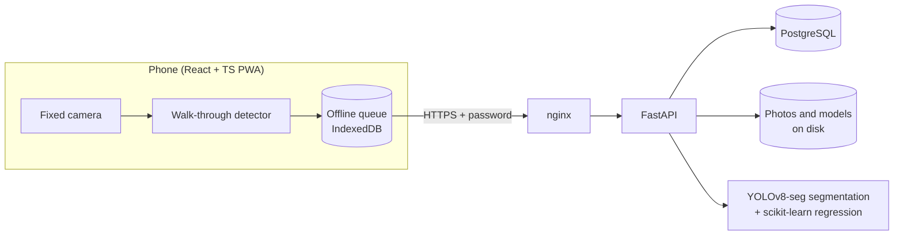

# PesoVivo — cattle weighing from images, no scale needed

[](https://github.com/Papacosta/pesovivo/actions/workflows/ci.yml)
[](LICENSE)

> 🇧🇷 [Versão em português (full documentation)](README.md)

**The problem:** livestock scales are expensive, heavy and require moving every animal onto
them. Many small and mid-size ranchers rarely weigh their cattle and make sales, feeding and
health decisions by eye.

**The solution:** a mobile app that estimates a steer's weight **from a side photo**, with the
phone mounted at a fixed spot in the corral. In **walk-through mode** the phone stays still by
the chute, detects each animal as it passes, picks the best frames and returns a weight with an
uncertainty range (`412 kg ± 25 kg`). The model learns **only from the rancher's own real
weighings**. No third-party dataset is used.

Built for real use on a farm. It works **offline**, because poor signal is the norm in the
field. It runs on a Mac with Docker, and the phone reaches it from anywhere through a
password-protected HTTPS link.

## Technical highlights

- **In-browser computer vision without a neural network:** a walk-through detector built on
  background subtraction over downscaled frames. Projection-based bounding boxes find the
  animal, and a state machine (enter → candidate → exit) handles animals walking nose-to-tail
  and stalled scenes ([`passageDetector.ts`](frontend/src/lib/passageDetector.ts)).
- **ML pipeline evaluated without leakage:**
  - The pipeline runs YOLOv8-seg segmentation, measures the silhouette, then fits Ridge or
    Gradient Boosting regression.
  - It is validated with **per-animal** `GroupKFold`, so photos of the same animal never leak
    across folds.
  - The uncertainty range is ±1.28 × the cross-validated MAE.
- **Robust per-pass aggregation:**
  - The weight is the median of the per-frame estimates.
  - Outlier frames are rejected using MAD (median absolute deviation).
  - The range accounts for how much the frames disagree.
- **Offline-first:** a PWA with an IndexedDB queue and client-generated UUIDs, so retries are
  **idempotent** and nothing is duplicated when connectivity returns.
- **Phone sensors:** tilt, GPS, ambient light and depth are stored with each photo (Postgres
  JSONB). Quality warnings flag problems instead of blocking the user.
- **Usability and accessibility:** the UI was reviewed against Nielsen's 10 heuristics and
  WCAG 2.1 AA. It has sufficient contrast, zoom enabled, labels on every field, a visible
  focus indicator, screen-reader announcements, clear validation messages and a warning
  before unsaved photos are lost.
- **Infrastructure:**
  - Docker Compose runs Postgres, FastAPI and nginx over HTTPS.
  - Alembic handles migrations.
  - Login uses a custom page and a signed session cookie that nginx verifies through
    `auth_request`. HTTP Basic Auth was dropped because iOS home-screen web apps never show
    its password prompt.
  - A permanent public link runs through Tailscale Funnel.
  - CI runs on GitHub Actions.

## Architecture



| Layer | Stack |
|---|---|
| Frontend | React, TypeScript, Vite, PWA (service worker), IndexedDB, Canvas, device sensor APIs |
| Backend | Python 3.12, FastAPI, SQLAlchemy 2, Pydantic v2, Alembic, OpenCV, scikit-learn |
| ML (optional) | Ultralytics YOLOv8-seg, PyTorch |
| Data | PostgreSQL (JSONB), files on a volume |
| Infra | Docker Compose, nginx, Tailscale Funnel / Cloudflare Tunnel, GitHub Actions |

## Status

- ✅ **Phase 1 (standardized data collection):** photos, sensors, real weighings, dashboard,
  CSV/ZIP export.
- ✅ **Walk-through mode:** automatic capture and per-animal estimates.
- ✅ **Handheld mode:** one tap, from a distance with 1×–5× zoom, no distance input: it is estimated from the phone angle and the hoof line ([`geometry.py`](backend/app/services/geometry.py)) and a "portable" model uses measurements in cm (error band 1.5× wider); category picked before the photo, result in **carcass arrobas** and a "Did it match what you expected?" question.
- ✅ **Phase 2 (estimation):** the pipeline is built and tested. **The model is activated only
  after enough real weighings are collected** (at least 30 animals). There are no field
  accuracy numbers yet.

## Run it

```bash
docker compose up --build
```

- PWA: https://localhost:5173
- API docs: http://localhost:8000/docs

See [README.md](README.md) for setup, the field workflow, remote access and the API reference.
The full documentation is in Portuguese.

## Tests

```bash
cd backend && pip install -r requirements.txt pytest && pytest -q
```

## License

[MIT](LICENSE)
